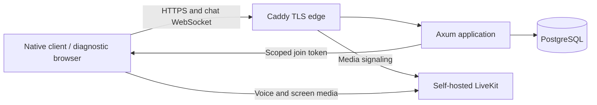

# Cordel

Cordel is an open source, self-hosted place for a community to talk in text, voice, and screen share. The first target is one invite-only community. Members can create text and voice channels; designated admins can manage the community and its members. The desktop client is designed around the **Journal**: conversation, people, and shared screens stay close together, and a screen share can move into its own window.

**Status:** Cordel is under development, not ready for community use. The Azure test host runs LiveKit and a standalone identity API. HTTPS, reboot recovery, disposable login and invitation flows, and an account-bound admin unlock passed focused checks. ADR-003 community and moderation code passed isolated PostgreSQL checks but is **not** on the VM. The native client, chat, real two-network media, backup/restore, and the integrated product still need work. See the [ADR progress view](docs/README.md) and [evidence ledger](docs/adr/STATUS.md).

## What the first version aims to do

- Keep one community private through invitations and personal login credentials. Public registration is disabled.
- Let members create channels, send durable text, join voice, and share or view screens.
- Start **every** account in the ordinary client view. A designated admin enters Management Mode in Settings with their **own** password and a short-lived server grant. There is no shared superadmin password.
- Put the Journal UI in a native Linux client first. A smaller browser client will exercise the same service contracts. macOS and Windows have later platform gates.
- Support formatted chat and private images after their storage, access, and recovery design is accepted. End-to-end encryption for text, images, voice, and screens is a final-release gate, not a first-test claim.

The planned 15-person, two-concurrent-share scenario is a load test target. It is not a verified capacity limit.

## Architecture at a glance

The first deployment uses one Linux VM with native `systemd` services. **Axum is the authority** for accounts, roles, chat access, moderation, and media admission. **PostgreSQL is the durable record** for identity and messages. **LiveKit forwards media**; chat history does not live in a media room. Caddy supplies the public TLS edge. Each client receives only the access it needs for its current session and room. The server is headless; management controls belong in the client, while host infrastructure and admin assignment stay with authorized operators.

The design makes a few deliberate tradeoffs:

| Choice | Reason and limit |
| --- | --- |
| One self-hosted installation | A community can operate its own service and data. The first host is a single failure domain, so off-host recovery remains mandatory before real users. |
| Separate durable chat and ephemeral media | Messages can be ordered and recovered after a WebSocket drop; LiveKit handles real-time voice and screens. Both paths still need shared authorization and revocation. |
| Native-first shared Rust state | Session, protocol, and reconnect logic can be reused across desktop platforms. Capture, permissions, audio, and packaging remain OS-specific and need real platform tests. |
| Per-account admin unlock | Routine use stays in the ordinary view. The server checks a short-lived grant and current role for management actions, supporting account-level audit and revocation. |
| Versioned client/server contract | Client and server work can advance against fixtures while integration is unfinished. A passing isolated component check is not a product test. |

These are Cordel's design priorities and tradeoffs, not a claim that other communication apps lack these features. Read the [deployment architecture](architecture.md), [network detail](docs/architecture/connectivity.md), and [security and operations detail](docs/architecture/operations.md) for the full proposal. The [v1 contract](docs/contracts/v1.md) defines component interfaces; Accepted and Proposed ADRs distinguish settled decisions from open designs.

## Current implementation and next gates

| Area | Current evidence | Still needed |
| --- | --- | --- |
| Test host and identity | Azure HTTPS, private-port checks, reboot recovery, disposable admin and user flows, and Management Mode grant smoke passed | Off-host restore, real-user readiness, and integrated client checks |
| Community policy | ADR-003 source passed format, Clippy, unit, disposable database, and restricted-role checks in Cloud Shell | VM deployment, live moderation, and chat/media policy consumers |
| Client | Shared protocol and state crates have isolated checks; provisional Phase 0 login and Settings UI source is on the feature branch | Linux build and UI evidence, real credential store, capture, playback, and end-to-end behavior |
| Chat, media, and browser | Architecture and contract boundaries are documented; LiveKit foundation is running | Durable chat, scoped media admission, two-network media proof, and browser security gate |

No ADR is currently `Done`. The first user-facing integrated product test begins only after all 16 [mandatory ADRs](docs/adr/README.md) have completion evidence. Technical and disposable checks run during implementation.

## Start here

| Goal | Read |
| --- | --- |
| See each ADR's estimated progress and next gate | [Documentation and ADR progress](docs/README.md) |
| Inspect decisions and verified results | [ADR index](docs/adr/README.md), [status ledger](docs/adr/STATUS.md), and [review](docs/adr/REVIEW-2026-10-18.md) |
| Understand ownership and interfaces | [Workstream map](docs/adr/WORKSTREAMS.md) and [v1 contract](docs/contracts/v1.md) |
| Understand the product interface | [Journal UX specification](docs/ux/journal.md) |
| Run a component or prepare deployment | [Deployment guide](deploy/README.md), [identity API](server/identity/README.md), [client state](client/state/README.md), and [Phase 0 client](client/phase0/README.md) |
| Read the original product vision | [Project vision (Portuguese)](Plano%20de%20Desenvolvimento%20-%20Revisado.md) |

## Repository map

| Path | Purpose |
| --- | --- |
| [`client/phase0`](client/phase0/README.md) | Linux native UI and media feasibility prototype |
| [`client/state`](client/state/README.md) | Shared session, recovery, and client state logic |
| [`protocol`](protocol/README.md) | Shared versioned Rust and JSON types |
| [`server/identity`](server/identity/README.md) | Standalone identity API and evolving community policy |
| [`docs/adr`](docs/adr/README.md) | Design decisions, review, and completion evidence |
| [`docs/contracts`](docs/contracts/v1.md) | Cross-component API and event contract |
| [`deploy`](deploy/README.md) | Native Linux deployment scripts and runbooks |

Each Rust crate has its own check instructions. There is not yet one command that launches a complete Cordel product.

## Contributing and licensing

Pick an ADR and read its contract handoff and open gates before editing. Use disposable data and report what was actually built and tested. Follow [AGENTS.md](AGENTS.md) for repository rules. Human-filed problems belong in [GitHub Issues](https://github.com/Antorsrj/Cordel/issues); agents fix their own discoveries within authorized work and record unresolved gates in the [status ledger](docs/adr/STATUS.md).

Cordel-authored source and documentation use [Apache-2.0](LICENSE). Third-party components retain their own terms. [ADR-106](docs/adr/client/ADR-106-license-distribution.md) and the [third-party inventory](docs/legal/THIRD_PARTY.md) describe the client attribution and package checks that remain before distributing binaries.
