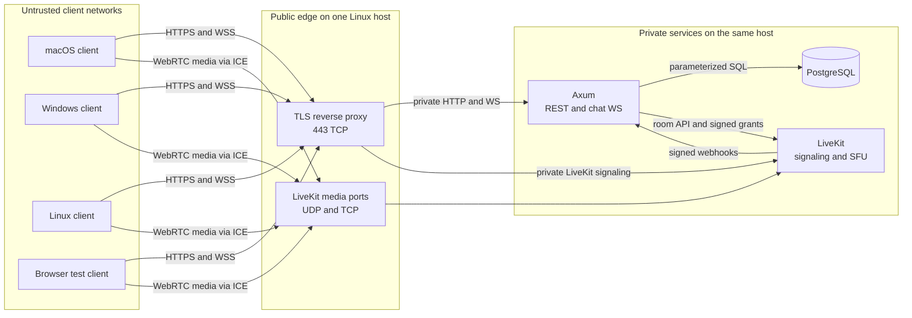
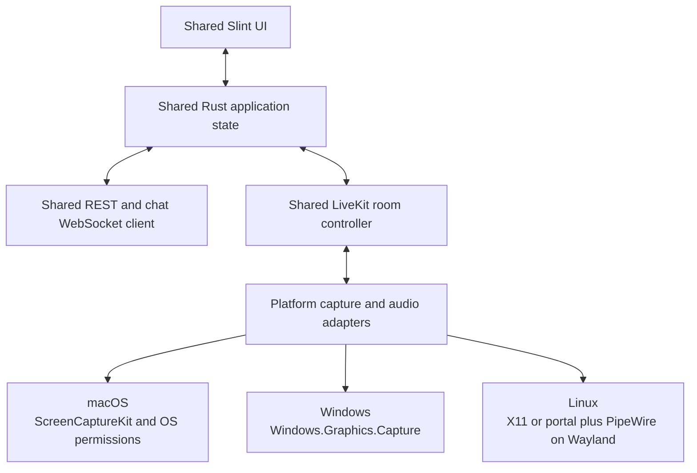
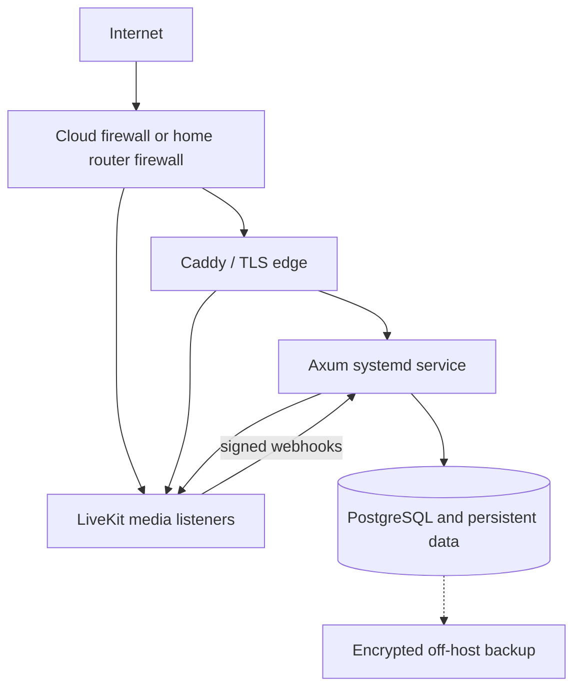

# Cordel deployment architecture

**Status:** Proposed deployment baseline

**Last reviewed:** 2026-10-18

**Scope:** One invite-only community on one Azure East US installation for the first test; 15 simultaneous users and two screen shares are a sizing example
**Related documents:** [Portuguese project vision](./Plano%20de%20Desenvolvimento%20-%20Revisado.md), [ADR index](./docs/adr/README.md), [implementation status](./docs/adr/STATUS.md), [independent workstreams](./docs/adr/WORKSTREAMS.md), [v1 app contract](./docs/contracts/v1.md), [Journal behavior](./docs/ux/journal.md), [parking lot](./PARKING_LOT.md)

**Detailed sections:** [Connectivity and distance](docs/architecture/connectivity.md) · [Capacity, security, and operations](docs/architecture/operations.md)

## 1. Decision and boundaries

Cordel uses one Linux host in Azure East US for its first test deployment. The same design can later run on another cloud VM or a home server with a publicly reachable address. The host runs the Rust Axum application, PostgreSQL, LiveKit Server, and Caddy as native `systemd` services; Docker is not part of the first-test server. The first native client target is Linux, followed by macOS and then Windows. Rust is the shared native client implementation language, Slint is the proposed UI, and LiveKit's Rust SDK carries media. Operating-system capture, permission, audio-device, and packaging code lives behind platform-specific adapters. A separate browser client exercises the system during testing; product-level browser support is a later decision.

The first version has one Discord-like community, with text and voice channels inside it. Its installation happens to use one physical host; the community and the host are distinct concepts. All members can create channels. The server is headless: clients provide the product UI, including admin controls for community settings and member management. Users cannot manage the community/server settings. Accounts are created only through admin-issued invitations, and each person registers a login and password. The server remains authoritative for accounts, membership, moderation, message history, and room admission. PostgreSQL stores durable state. Axum exposes HTTPS and WebSocket endpoints and signs narrowly scoped LiveKit room tokens. LiveKit is an SFU: clients send each media track once to it, and it forwards tracks to authorized subscribers. Peer-to-peer media is outside the current design. No Redis, Kubernetes, recording, or ingress is required for the first single-node installation. Approved image chat adds a private attachment volume under ADR-011 before that feature ships.

This is the target deployment architecture, not a claim that the complete client or server is implemented. The Azure host runs a standalone identity API and LiveKit foundation; the [status ledger](./docs/adr/STATUS.md) records the remaining integration gates. The CPU and bandwidth figures in the [operations detail](docs/architecture/operations.md) are planning estimates that need a real client and LiveKit load test.

Contributors can build server and client workstreams separately using the versioned [v1 application contract](./docs/contracts/v1.md) and the ownership/integration gates in [WORKSTREAMS.md](./docs/adr/WORKSTREAMS.md). The contract spans implemented and future routes; only the standalone identity subset is deployed. Proposed browser-auth, media-revocation, image-storage, and E2EE details retain their ADR gates. The [written Journal specification](./docs/ux/journal.md) records the approved UI behavior without requiring mock files in Git. The first integrated product test waits until every mandatory Linux/browser ADR is Done in [STATUS.md](./docs/adr/STATUS.md); technical proofs required to reach that state run during implementation. macOS, Windows, and E2EE have later gates.

### Service ownership

| Component | Runs where | Responsibility | Durable data |
| --- | --- | --- | --- |
| Desktop client | User's macOS, Windows, or Linux device | Journal UI and authorized admin controls, local device access, REST/WS client, WebRTC publisher/subscriber, detachable share window | Refresh token in the OS credential store; local cache may be discarded |
| Browser test client | User's browser | Test registration, text, voice, and screen sharing against the same server contracts; features can be narrower than desktop | HttpOnly server-bound cookie; no durable bearer in JavaScript storage, pending ADR-009 acceptance |
| TLS edge (Caddy or equivalent) | Server | Public HTTPS/WSS, certificates, routing to Axum and LiveKit signaling | Certificates and small configuration |
| Axum | Server | Auth, authorization, REST, chat/presence WebSocket, protected image access, LiveKit token issuance, webhook handling | None outside PostgreSQL and the proposed private image volume |
| PostgreSQL | Server, private interface | Users, sessions, membership, roles, channels, messages, channel sequence numbers | Primary durable database |
| LiveKit Server | Server | Signaling, ICE, TURN when enabled, media forwarding, room participants | Ephemeral room state |
| Private image volume | Server, private filesystem | Proposed image bytes and previews under ADR-011 | Image attachments when enabled |
| Backup target | Separate failure domain | Encrypted database, image, and configuration recovery material | Backup copies |

## 2. Trust and traffic map

The arrows are trust boundaries. A client never receives a database credential or the LiveKit API secret. The Axum JWT and LiveKit join token are separate credentials. WebRTC media does **not** pass through Axum or the HTTPS reverse proxy. Its route is selected by ICE and may use direct UDP, ICE/TCP, or TURN.

### Public endpoints and DNS

The Azure first test has two Azure-provided names, `cordel-media-f77cc05e.eastus.cloudapp.azure.com` and `cordel-turn-f77cc05e.eastus.cloudapp.azure.com`, on separate public IP resources attached to one VM. The owner's Cloud Shell output verified that the names resolve to their assigned public addresses and that Ubuntu has both private IPs. Caddy now routes `/v1/*` on the media hostname to the standalone Axum identity API on loopback and other paths to LiveKit signaling; a separate app hostname can be added when a project domain exists. The diagnostic browser is not deployed. The general deployment pattern can use separate names such as `api.cordel.example`, `media.cordel.example`, and `turn.cordel.example`. The desktop application is configured with the application HTTPS URL; a future media-admission component will return the media signaling URL and a room token after authorization. Do not let arbitrary client input choose the LiveKit URL. Both Azure hostnames have trusted certificates; Cloud Shell verified identity HTTPS rejection of public registration, media HTTPS, TURN TLS, ICE/TCP, and a TURN/UDP STUN Binding response. ICE/UDP media, authenticated TURN allocations, and a second external network remain unverified.

| Exposure | Purpose | Policy |
| --- | --- | --- |
| 443/TCP | App HTTPS/WSS and LiveKit signaling through TLS edge | Public |
| 80/TCP | Certificate issuance or redirect, if the chosen ACME method requires it | Public only as needed |
| 7882/UDP **or** 50000–60000/UDP | LiveKit host media candidates | Public; choose one media-port strategy |
| 7881/TCP | LiveKit ICE/TCP fallback | Public if enabled |
| 3478/UDP | Embedded TURN/STUN fallback | Public if enabled |
| TURN/TLS on secondary IP TCP/443 | Last-resort media path for restrictive networks | Public; native LiveKit listener with a valid certificate for the TURN hostname |
| 22/TCP | Administration | VPN or a narrow administrator allowlist; never open to everyone by default |
| 5432/TCP, Axum private port, LiveKit API port 7880 | Database and internal APIs | Never public |

LiveKit's [port reference](https://docs.livekit.io/transport/self-hosting/ports-firewall/) documents both the normal UDP port range and optional single-port UDP mux (`rtc.udp_port`, commonly 7882). The Azure first test uses UDP mux on 7882 because that is the opened NSG route; load-test it. Do not enable both the mux and port range. The official [VM deployment guide](https://docs.livekit.io/transport/self-hosting/vm/) uses Docker and assumes two names on one public IP, so its generated deployment is reference material only for the chosen native two-IP layout. Pin the LiveKit release and verify the actual `turn.bind_addresses`, certificate, and port behavior before external tests.

## 4. Client architecture

Rust is the common language for UI integration, state, REST/WS, authentication flow, and media orchestration. Slint provides one declarative UI codebase. LiveKit's Rust SDK lists Windows, macOS, and Linux as supported platforms, but that does not remove OS-specific capture and distribution work. [Slint desktop support](https://slint.dev/desktop); [LiveKit Rust SDK](https://github.com/livekit/rust-sdks).

| Platform | Capture and permissions to validate | Distribution to validate |
| --- | --- | --- |
| macOS | ScreenCaptureKit, screen recording and microphone consent, display changes | Universal or separate architectures, signing, notarization, update path |
| Windows | Windows.Graphics.Capture picker, microphone access, device changes | Installer, signing, runtime dependencies, update path |
| Linux | X11 capture separately from Wayland portal/PipeWire flow, microphone through the selected audio stack | Packaging target and library compatibility across distributions |

The OS APIs above are candidates to prototype, not a claim that they are wired into the Rust SDK today. The shared interface should produce audio samples and video frames in a format the LiveKit SDK accepts and consume decoded remote frames for Slint. The Phase 0 gate is **Linux only**: demonstrate two-person audio plus capture/publication, then receive and display two independent remote screen tracks and detach one into a second window; examine X11 and Wayland separately. Device switching, sleep/wake recovery, packaging, and the corresponding macOS and Windows gates follow in later platform stages. [Apple ScreenCaptureKit](https://developer.apple.com/documentation/ScreenCaptureKit); [Windows capture](https://learn.microsoft.com/en-us/windows/apps/develop/media-authoring-processing/screen-capture); [XDG ScreenCast portal](https://flatpak.github.io/xdg-desktop-portal/docs/doc-org.freedesktop.portal.ScreenCast.html).

Store refresh credentials in macOS Keychain, Windows Credential Manager, or the Linux desktop's selected Secret Service implementation. Keep short-lived access and LiveKit tokens in process memory. The client cache is not authoritative. Never ship the LiveKit API secret or a database password in a desktop binary.

## 5. Single-host deployment layout

The maintained deployment procedure is in [`deploy/`](./deploy/README.md). The first-test VM runs native Ubuntu services under `systemd`: packaged PostgreSQL, Caddy, a pinned LiveKit binary, and a standalone Axum identity binary. Redis is omitted on the single node. PostgreSQL and Axum listen only on loopback; LiveKit signaling listens on the primary private interface for Caddy to reach it, with raw port 7880 blocked by the NSG and host firewall. Caddy routes `/v1/*` to Axum and the remaining media paths to LiveKit. The deployed binary implements the standalone ADR-002 identity API with account-bound admin grants; ADR-003 community policy exists in verified source but is not deployed. This is not an integrated Cordel API. Each service has its own account, writable directories, restart policy, and version/rollback record. Caddy binds HTTP/HTTPS on the primary private IP; LiveKit's TURN/TLS and TURN/UDP listeners bind to the secondary private IP. The TURN Certbot staging renewal and deploy-hook path passed once. Caddy media certificate renewal and real media paths still need proof before the host is ready. Public identity HTTPS, reboot recovery, and focused disposable login, grant, and invitation checks passed. The integrated product remains untested.

The host firewall and cloud firewall should agree. Bind PostgreSQL and Axum to loopback. Bind LiveKit to the primary private interface for signaling and RTC, but block raw API port 7880 from the Internet at both firewall layers. Keep the Azure NSG limited to the selected public ports and a narrow SSH source. Use a dedicated database role for Axum with only the required schema privileges, a separate migration role, and no public PostgreSQL listener.

### Installation sequence

1. Provision a supported Linux installation, time synchronization, a dedicated administrator account, automatic security updates where appropriate, and a disk with enough free space for PostgreSQL and backups in progress.
2. Assign the public address and DNS names. For home hosting, first prove the address is inbound-reachable from a separate network; check for ISP CGNAT and double NAT.
3. Use the Azure test's UDP mux on 7882 and open exactly the selected ports in the cloud firewall and host firewall. A later provider can choose a range only after changing and verifying its firewall.
4. Install PostgreSQL from the supported Ubuntu package, Caddy from a maintained package source, and a pinned, checksum-verified LiveKit Linux release. Define native `systemd` units and service users. Configure Caddy on the primary private IP and LiveKit TURN on the secondary private IP. Issue and renew valid certificates for both names; verify TCP/443 listeners do not conflict.
5. Keep PostgreSQL data on the host disk with loopback-only binding. Add a private image directory before enabling image chat. Configure consistent encrypted, off-host backups of both data stores before admitting real users to that feature.
6. Deploy Axum with a database URL, JWT signing material, LiveKit API key/secret, public media URL, webhook key, and explicit proxy-trust settings. Store secrets outside the repository with restrictive file access or a host secret facility.
7. Run versioned SQLx migrations with the migration identity. Start Axum only after PostgreSQL is healthy, and start public traffic only after Axum and LiveKit health checks pass.
8. Add the application hostname to the TLS edge. Verify HTTPS certificates, WebSocket upgrades, LiveKit signaling, UDP media, ICE/TCP, and TURN from an external network.
9. Bootstrap the first admin with a one-time local procedure. Have that admin issue a test invitation; create the invited user with a login and password. Exercise text, voice, and two simultaneous screen shares. Test with a client behind CGNAT and one on a restricted network.
10. Record package and binary versions, checksums, DNS records, firewall rules, certificate renewal, backup location, and recovery steps in the operator runbook.

### Cloud VM versus home server

| Concern | Cloud VM | Home server |
| --- | --- | --- |
| Public address | Usually direct or provider NAT with known mapping | Must confirm public IPv4 or viable dual-stack IPv6; CGNAT can block inbound hosting |
| Bandwidth | Check port speed, sustained egress, and monthly transfer charges | Check sustained **upload**, data caps, and ISP policy |
| Availability | Provider power and network; still a single failure domain | Power, router, ISP, and address changes add failure modes |
| Firewall | Provider rules plus host firewall | Router forwarding plus host firewall; double NAT may need two mappings |
| Certificates | Public DNS and ACME validation | Same, plus dynamic DNS and hairpin/split-DNS checks |
| Backup | Separate provider/region or storage account | Off-site target; a second disk in the same home is insufficient for site loss |

## Further detail

- [Client connectivity, NAT/CGNAT, and distance](docs/architecture/connectivity.md)
- [Capacity, security, backup, operating gates, and open decisions](docs/architecture/operations.md)
