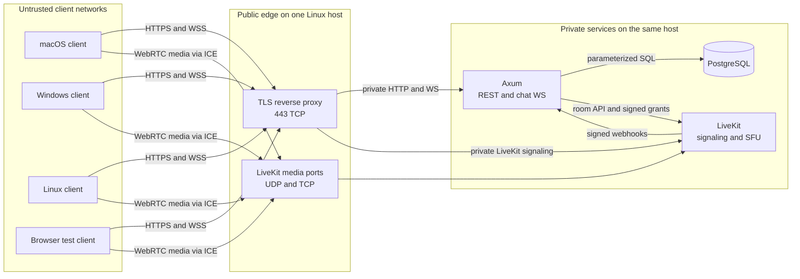
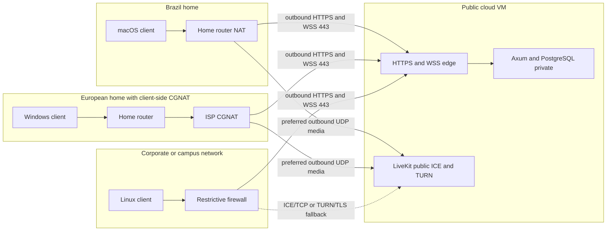
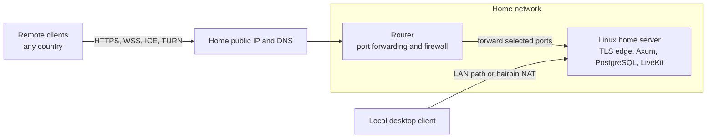
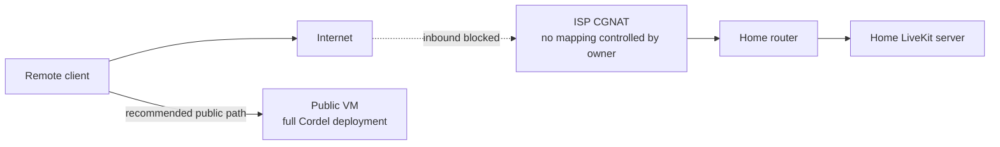
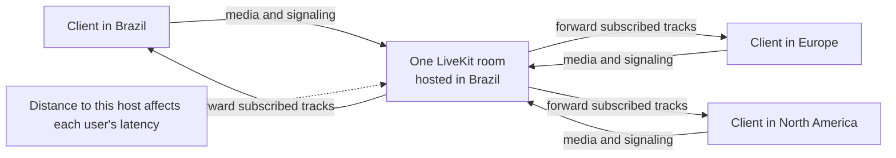
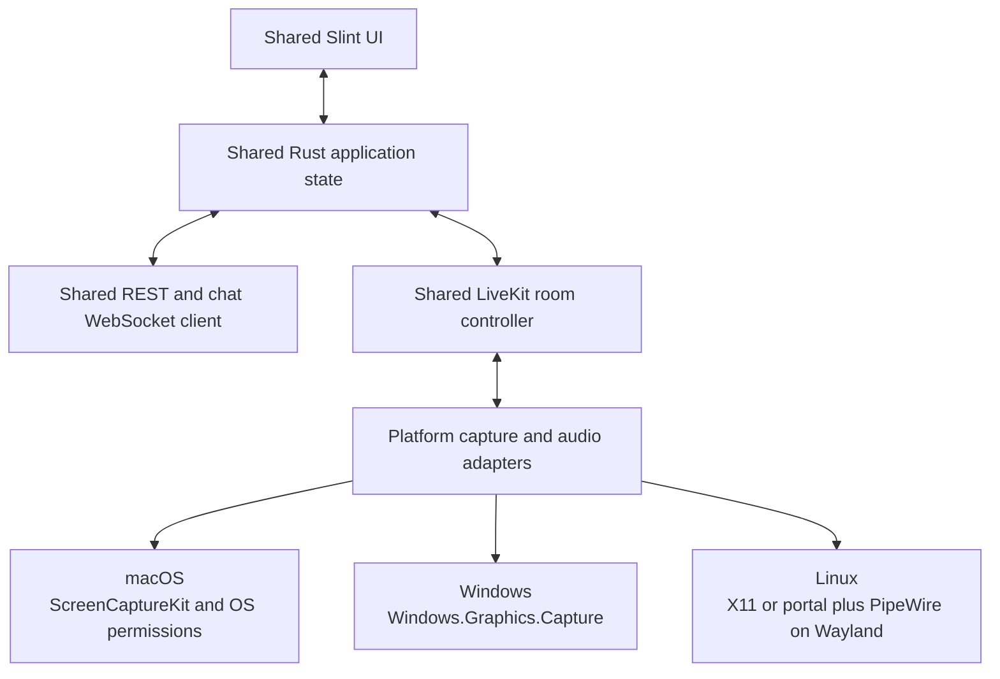
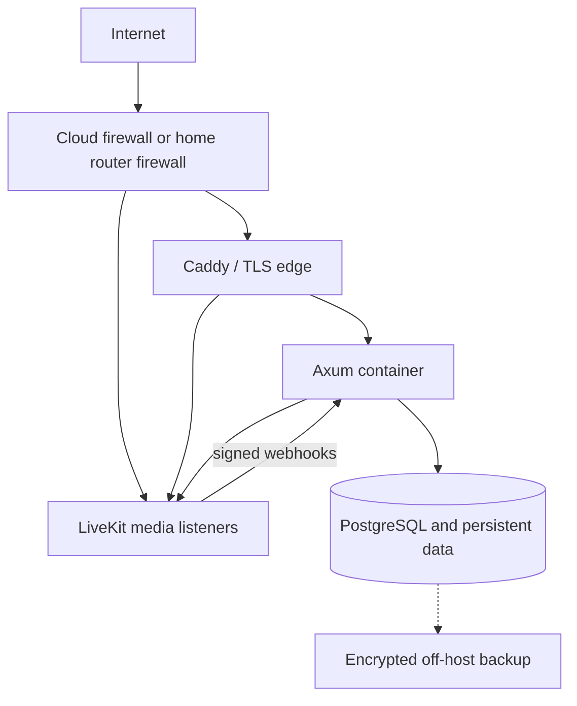

# Cordel deployment architecture

**Status:** Proposed deployment baseline

**Last reviewed:** 2026-10-17

**Scope:** One invite-only community on one Brazil-hosted installation for the first test; 15 simultaneous users and two screen shares are a sizing example
**Related documents:** [Portuguese project vision](./Plano%20de%20Desenvolvimento%20-%20Revisado.md), [ADR index](./docs/adr/README.md), [implementation status](./docs/adr/STATUS.md), [independent workstreams](./docs/adr/WORKSTREAMS.md), [v1 app contract](./docs/contracts/v1.md), [Journal behavior](./docs/ux/journal.md), [parking lot](./PARKING_LOT.md)

## 1. Decision and boundaries

Cordel uses one Linux host in Brazil for its first test deployment. The same design works on a cloud VM or a home server with a publicly reachable address. The host runs the Rust Axum application, PostgreSQL, LiveKit Server, and a TLS reverse proxy. The first native client target is Linux, followed by macOS and then Windows. Rust is the shared native client implementation language, Slint is the proposed UI, and LiveKit's Rust SDK carries media. Operating-system capture, permission, audio-device, and packaging code lives behind platform-specific adapters. A separate browser client exercises the system during testing; product-level browser support is a later decision.

The first version has one Discord-like community, with text and voice channels inside it. Its installation happens to use one physical host; the community and the host are distinct concepts. All members can create channels. The server is headless: clients provide the product UI, including admin controls for community settings and member management. Users cannot manage the community/server settings. Accounts are created only through admin-issued invitations, and each person registers a login and password. The server remains authoritative for accounts, membership, moderation, message history, and room admission. PostgreSQL stores durable state. Axum exposes HTTPS and WebSocket endpoints and signs narrowly scoped LiveKit room tokens. LiveKit is an SFU: clients send each media track once to it, and it forwards tracks to authorized subscribers. Peer-to-peer media is outside the current design. No Redis, Kubernetes, recording, or ingress is required for the first single-node installation. Approved image chat adds a private attachment volume under ADR-011 before that feature ships.

This is a deployment architecture, not a claim that the clients or server have already been implemented. The CPU and bandwidth figures below are planning estimates and must be checked with a real client and LiveKit load test.

Contributors can build server and client workstreams separately using the versioned [v1 application contract](./docs/contracts/v1.md) and the ownership/integration gates in [WORKSTREAMS.md](./docs/adr/WORKSTREAMS.md). The contract is an implementation baseline, not a deployed API. Proposed browser-auth, media-revocation, image-storage, and E2EE details retain their ADR gates. The [written Journal specification](./docs/ux/journal.md) records the approved UI behavior without requiring mock files in Git. The first integrated product test waits until every mandatory Linux/browser ADR is Done in [STATUS.md](./docs/adr/STATUS.md); technical proofs required to reach that state run during implementation. macOS, Windows, and E2EE have later gates.

### Service ownership

| Component | Runs where | Responsibility | Durable data |
| --- | --- | --- | --- |
| Desktop client | User's macOS, Windows, or Linux device | Journal UI and authorized admin controls, local device access, REST/WS client, WebRTC publisher/subscriber, detachable share window | Refresh token in the OS credential store; local cache may be discarded |
| Browser test client | User's browser | Test registration, text, voice, and screen sharing against the same server contracts; features can be narrower than desktop | HttpOnly server-bound cookie; no durable bearer in JavaScript storage, pending ADR-009 acceptance |
| TLS edge (Caddy or equivalent) | Server | Public HTTPS/WSS, certificates, routing to Axum and LiveKit signaling | Certificates and small configuration |
| Axum | Server | Auth, authorization, REST, chat/presence WebSocket, protected image access, LiveKit token issuance, webhook handling | None outside PostgreSQL and the proposed private image volume |
| PostgreSQL | Server, private interface | Users, sessions, membership, roles, channels, messages, channel sequence numbers | Primary durable database |
| LiveKit Server | Server | Signaling, ICE, TURN when enabled, media forwarding, room participants | Ephemeral room state |
| Private image volume | Server, private filesystem | Proposed image bytes and previews under ADR-011 | Image attachments when enabled |
| Backup target | Separate failure domain | Encrypted database, image, and configuration recovery material | Backup copies |

## 2. Trust and traffic map



The arrows are trust boundaries. A client never receives a database credential or the LiveKit API secret. The Axum JWT and LiveKit join token are separate credentials. WebRTC media does **not** pass through Axum or the HTTPS reverse proxy. Its route is selected by ICE and may use direct UDP, ICE/TCP, or TURN.

### Public endpoints and DNS

Use separate DNS names for the application, media signaling, and TURN, such as `api.cordel.example`, `media.cordel.example`, and `turn.cordel.example`. These are illustrative names; actual domains belong in deployment configuration. Each public name resolves to the cloud VM's public address or the home router's public address. The desktop application is configured with the application HTTPS URL; Axum returns the media signaling URL and a room token after authorization. Do not let arbitrary client input choose the LiveKit URL.

| Exposure | Purpose | Policy |
| --- | --- | --- |
| 443/TCP | App HTTPS/WSS and LiveKit signaling through TLS edge | Public |
| 80/TCP | Certificate issuance or redirect, if the chosen ACME method requires it | Public only as needed |
| 7882/UDP **or** 50000–60000/UDP | LiveKit host media candidates | Public; choose one media-port strategy |
| 7881/TCP | LiveKit ICE/TCP fallback | Public if enabled |
| 3478/UDP | Embedded TURN/STUN fallback | Public if enabled |
| TURN/TLS listener | Last-resort media path for restrictive networks | Public; follow the generated LiveKit/Caddy configuration for the exact listener and TLS routing |
| 22/TCP | Administration | VPN or a narrow administrator allowlist; never open to everyone by default |
| 5432/TCP, Axum private port, LiveKit API port 7880 | Database and internal APIs | Never public |

LiveKit's [port reference](https://docs.livekit.io/transport/self-hosting/ports-firewall/) documents both the normal UDP port range and optional single-port UDP mux (`rtc.udp_port`, commonly 7882). Use the mux when a home router or firewall makes a wide range impractical, then load-test it. Do not enable both the mux and port range in an ad hoc way. The official [VM deployment generator](https://docs.livekit.io/transport/self-hosting/vm/) is the starting point for production TLS and TURN routing; its generated port choices take precedence over the illustrative list above.

## 3. Client connectivity: NAT, CGNAT, and distance

### 3.1 Public cloud VM, clients on different networks

Client-side NAT, including CGNAT, usually permits outbound connections. It does not require inbound router forwarding at the client's home. Axum signaling uses outbound HTTPS/WSS. WebRTC ICE tests available paths to the public LiveKit host. A restrictive client network may need TCP or TURN. The server therefore needs reachable media endpoints even though most clients do not.



The dotted fallback is a possibility, not a guarantee. Firewall policies vary. A client behind CGNAT can still reach a public LiveKit server through outbound traffic; TURN is used only when ICE cannot select a better path. TURN on the **same** server does not eliminate its bandwidth cost. It adds an extra relay leg and can increase latency. Verify UDP, TCP, and TURN behavior from real residential and corporate networks before calling connectivity complete. See [WebRTC's ICE and TURN explanation](https://webrtc.org/getting-started/peer-connections) and [TURN guidance](https://webrtc.org/getting-started/turn-server).

### 3.2 Home server with a public address on its router

A home server commonly has a private LAN address. The router must forward the public TCP and UDP ports used by the selected LiveKit configuration to that server. A public IPv4 address may be dynamic; dynamic DNS can update the names, but address changes can interrupt active rooms. Use a DHCP reservation or static LAN address for the server. Keep DNS TTLs reasonably short if the public address changes. Certificate issuance requires public DNS and a reachable ACME challenge route, unless using a supported DNS challenge. The home's **upload** bandwidth is the effective outbound capacity to participants.



Local clients should be tested separately: some routers do not support hairpin NAT for the public DNS name. Split-horizon DNS can resolve the same hostname to the server's LAN address internally while preserving valid TLS names. Local network success does not prove remote Internet reachability.

### 3.3 Home server behind server-side CGNAT

This is materially different from a **client** behind CGNAT. If the ISP does not provide an inbound-reachable public IPv4 address, ordinary port forwarding on the home router cannot expose LiveKit to the Internet. A generic HTTPS tunnel may expose Axum signaling but does not automatically carry LiveKit's UDP media. IPv6 can help only if the server has globally reachable IPv6 and every intended client has a working compatible path; dual-stack access still needs a plan.



**Decision:** obtain a public address from the ISP or place the complete public deployment on a VM. A public VM carrying only TURN while the SFU stays behind CGNAT is possible in specialized designs, but it adds relaying, reachability, and operations complexity without reducing the public bandwidth bill. Do not choose it for the first deployment.

### 3.4 People in different countries

One LiveKit room is hosted on one LiveKit node, even in a distributed LiveKit cluster. In the first test deployment every participant's media goes through Brazil. Axum and PostgreSQL live on the same host so chat and authorization do not add a second cross-region hop. A participant far from the host can have a higher round-trip time; adding regional application replicas alone does not shorten the media path for that room. Measure end-to-end latency and packet loss from the intended countries before considering a different region or multi-region deployment. [LiveKit's distributed deployment guide](https://docs.livekit.io/transport/self-hosting/distributed/) describes the one-node-per-room constraint.



Two European participants in the same room still exchange media through Brazil. This is an architectural path statement, not a fixed latency estimate. Measure RTT and jitter from the intended countries. If international use later dominates, evaluate region selection per room and a distributed deployment; that is a separate scaling decision and requires Redis and more than one node.

### 3.5 Session establishment and media path

```mermaid
sequenceDiagram
  participant C as Desktop client
  participant A as Axum
  participant D as PostgreSQL
  participant L as LiveKit
  C->>A: HTTPS login or token refresh
  A->>D: Validate account and session
  A-->>C: Short-lived app access token
  C->>A: WSS chat connect with app token
  A-->>C: Authorized channel events
  C->>A: POST voice token for channel
  A->>D: Check current membership and CONNECT_VOICE
  A-->>C: Room-scoped LiveKit token and media URL
  C->>L: WSS LiveKit signaling
  C->>L: ICE candidate checks; UDP preferred
  Note over C,L: ICE/TCP or TURN may be selected instead
  C->>L: Encrypted WebRTC microphone and screen tracks
  L-->>C: Subscribed tracks from other participants
  L->>A: Signed participant webhook
  A->>L: Participant reconciliation or removal if needed
```

Webhooks update the UI's view of voice presence but are not an authorization source. Axum checks the database before issuing each new room token. The client obtains any replacement app token through the app's session flow, not from LiveKit.

### 3.6 Invitation, reconnection, and moderation

```mermaid
sequenceDiagram
  participant Admin
  participant Invitee
  participant Client
  participant Axum
  participant DB as PostgreSQL
  participant LK as LiveKit
  Admin->>Axum: Create invitation (authenticated admin)
  Axum->>DB: Store expiring, limited-use invite
  Axum-->>Admin: Shareable invite code
  Admin-->>Invitee: Give invite code
  Invitee->>Axum: Redeem invite and choose login/password
  Axum->>DB: Atomically consume invite, create account and membership
  Axum-->>Invitee: Authenticated session
  Client->>Axum: Reconnect after network drop
  Axum->>DB: Recheck session, membership, kick/ban state
  Axum-->>Client: Resume if still authorized; recover missed messages
  Admin->>Axum: Kick a user for 30+ minutes or ban a user
  Axum->>DB: Persist restriction
  Axum-->>Client: Close affected app and chat access
  Axum->>LK: Remove active participant
  Client->>Axum: Attempt new app/media admission
  Axum-->>Client: Deny while restriction remains
```

The last denial represents Axum's own endpoints. A previously issued self-hosted LiveKit token may still reach LiveKit directly; section 7 and the parking lot track the additional enforcement needed. Invite redemption must be atomic so a single-use code cannot create two accounts under concurrent requests.

### 3.7 Browser test path

The browser test client calls the same HTTPS API and uses LiveKit's browser SDK for microphone and screen sharing. It does not reuse the native Rust media or Slint UI code. Browser WebSocket APIs cannot set a custom `Authorization` request header, so the browser needs a deliberately designed authentication method, such as a short-lived, single-use WebSocket ticket obtained over authenticated HTTPS or a secure same-site cookie. Do not place a long-lived bearer token in a WebSocket URL. Scope browser credentials and CORS/origin rules to the deployment's actual domain. The browser is a test surface; parity with all native features is not an initial gate.

## 4. Client architecture

Rust is the common language for UI integration, state, REST/WS, authentication flow, and media orchestration. Slint provides one declarative UI codebase. LiveKit's Rust SDK lists Windows, macOS, and Linux as supported platforms, but that does not remove OS-specific capture and distribution work. [Slint desktop support](https://slint.dev/desktop); [LiveKit Rust SDK](https://github.com/livekit/rust-sdks).



| Platform | Capture and permissions to validate | Distribution to validate |
| --- | --- | --- |
| macOS | ScreenCaptureKit, screen recording and microphone consent, display changes | Universal or separate architectures, signing, notarization, update path |
| Windows | Windows.Graphics.Capture picker, microphone access, device changes | Installer, signing, runtime dependencies, update path |
| Linux | X11 capture separately from Wayland portal/PipeWire flow, microphone through the selected audio stack | Packaging target and library compatibility across distributions |

The OS APIs above are candidates to prototype, not a claim that they are wired into the Rust SDK today. The shared interface should produce audio samples and video frames in a format the LiveKit SDK accepts and consume decoded remote frames for Slint. The Phase 0 gate is **Linux only**: demonstrate two-person audio plus capture/publication, then receive and display two independent remote screen tracks and detach one into a second window; examine X11 and Wayland separately. Device switching, sleep/wake recovery, packaging, and the corresponding macOS and Windows gates follow in later platform stages. [Apple ScreenCaptureKit](https://developer.apple.com/documentation/ScreenCaptureKit); [Windows capture](https://learn.microsoft.com/en-us/windows/apps/develop/media-authoring-processing/screen-capture); [XDG ScreenCast portal](https://flatpak.github.io/xdg-desktop-portal/docs/doc-org.freedesktop.portal.ScreenCast.html).

Store refresh credentials in macOS Keychain, Windows Credential Manager, or the Linux desktop's selected Secret Service implementation. Keep short-lived access and LiveKit tokens in process memory. The client cache is not authoritative. Never ship the LiveKit API secret or a database password in a desktop binary.

## 5. Single-host deployment layout

The recommended production baseline is a maintained Linux host with a public IP and a domain. Deploy the services with version-pinned containers under Docker Compose, using the official LiveKit VM generator for its LiveKit/Caddy/TURN portion. Add Axum and PostgreSQL as separate services on a private application network, with persistent PostgreSQL storage. The generator may include Redis; that can be retained if its generated configuration uses it, although Cordel's single-node chat event bus does not require Redis. The exact Compose file should be generated and reviewed once domain names, OS, and versions are known; hand-written partial TURN/TLS routing is error-prone. The [official VM guide](https://docs.livekit.io/transport/self-hosting/vm/) supplies the deployment generator and its firewall requirements.



The host firewall and cloud firewall should agree. Bind or firewall PostgreSQL, the Axum container port, and LiveKit's raw API port so they cannot be reached from the Internet. Docker's published-port behavior must be reviewed against the host firewall; publishing a private port to `0.0.0.0` can bypass assumptions about local-only access. Use a dedicated database role for Axum with only the required schema privileges, a separate migration role, and no public PostgreSQL listener.

### Installation sequence

1. Provision a supported Linux installation, time synchronization, a dedicated administrator account, automatic security updates where appropriate, and a disk with enough free space for PostgreSQL and backups in progress.
2. Assign the public address and DNS names. For home hosting, first prove the address is inbound-reachable from a separate network; check for ISP CGNAT and double NAT.
3. Decide on the LiveKit UDP strategy: the generated range or UDP mux. Open exactly the chosen ports in the cloud firewall or home router and host firewall.
4. Generate the LiveKit VM configuration for the real domains. Review its Caddy, TURN, TLS, port, and Redis settings instead of assuming example defaults. Pin container versions rather than tracking `latest` in production.
5. Add PostgreSQL with a persistent volume and private binding. Add a private image volume before enabling image chat. Configure consistent encrypted, off-host backups of both data stores before admitting real users to that feature.
6. Deploy Axum with a database URL, JWT signing material, LiveKit API key/secret, public media URL, webhook key, and explicit proxy-trust settings. Store secrets outside the repository with restrictive file access or a host secret facility.
7. Run versioned SQLx migrations with the migration identity. Start Axum only after PostgreSQL is healthy, and start public traffic only after Axum and LiveKit health checks pass.
8. Add the application hostname to the TLS edge. Verify HTTPS certificates, WebSocket upgrades, LiveKit signaling, UDP media, ICE/TCP, and TURN from an external network.
9. Bootstrap the first admin with a one-time local procedure. Have that admin issue a test invitation; create the invited user with a login and password. Exercise text, voice, and two simultaneous screen shares. Test with a client behind CGNAT and one on a restricted network.
10. Record the versions, DNS records, firewall rules, backup location, and recovery steps in the operator runbook.

### Cloud VM versus home server

| Concern | Cloud VM | Home server |
| --- | --- | --- |
| Public address | Usually direct or provider NAT with known mapping | Must confirm public IPv4 or viable dual-stack IPv6; CGNAT can block inbound hosting |
| Bandwidth | Check port speed, sustained egress, and monthly transfer charges | Check sustained **upload**, data caps, and ISP policy |
| Availability | Provider power and network; still a single failure domain | Power, router, ISP, and address changes add failure modes |
| Firewall | Provider rules plus host firewall | Router forwarding plus host firewall; double NAT may need two mappings |
| Certificates | Public DNS and ACME validation | Same, plus dynamic DNS and hairpin/split-DNS checks |
| Backup | Separate provider/region or storage account | Off-site target; a second disk in the same home is insufficient for site loss |

## 6. Capacity and bandwidth

The initial planning envelope is 15 participants in **one** voice room, two distinct screen-share publishers, and all other participants watching both shares. No recording, transcoding, camera video, or arbitrary file attachments are assumed. Image messages are now in scope under ADR-011 and require separate storage sizing; this media-only bandwidth estimate excludes image transfers. A screen-share budget of 2.5–4 Mbps is an illustrative target to test on the actual Rust client, not a LiveKit-guaranteed encoding rate.

Each of the two publishers sends one screen track to LiveKit. Fourteen other participants can subscribe to each track: `2 × 14 × 2.5–4 Mbps = 70–112 Mbps` of screen-share egress. If all 15 microphones transmitted continuously at 64 kbps to 14 peers, voice egress would add about `15 × 14 × 0.064 = 13.4 Mbps`; typical silence suppression should reduce it. Reserve roughly 20–30% headroom for packet overhead, retransmissions, signaling, and variation. A practical initial planning range is roughly **100–160 Mbps outbound** while everyone watches both shares. Each viewer needs roughly **5–8 Mbps download** for the two shares, plus voice and headroom.

Start with **4 dedicated vCPU, 8 GB RAM, 50 GB SSD, and a 1 Gbps port** for the combined single host. The 50 GB disk figure predates image messages and must be recalculated after setting image upload limits and retention. Obtain at least **200 Mbps sustained outbound capacity** for the stated worst-case media scenario; 300 Mbps gives more room for bitrate spikes and additional services. This is an engineering starting point, not a benchmark result. For a home server, measured upload after other household traffic must meet the same requirement. At 150 Mbps for four hours every day, outbound transfer is approximately 8.1 TB per 30-day month. Check provider transfer allowances or home data caps before deployment.

Measure CPU, memory, actual track bitrate, packets per second, egress, packet loss, RTT, and client quality at 15 users with two screen shares. Run LiveKit's [load test](https://docs.livekit.io/transport/self-hosting/benchmark) from a **separate** adequately provisioned machine, then repeat with real desktop clients because the synthetic test may not reproduce text-heavy screen content or OS capture behavior. If egress is lower than expected, verify viewers are actually subscribed to both high-quality tracks. If it is higher, inspect simulcast layers, retransmissions, and any additional published tracks. Add capacity based on measurements, not participant count alone.

## 7. Security model

### Identity, sessions, and permissions

- Version one has one community and two in-app roles: `user` and `admin`. Every authenticated member can create text and voice channels. Only admins may edit the first-test community name and description or manage members through the client; a `user` cannot. An admin can invite, kick, ban, lengthen a kick, or lift a ban for a `user`; admins cannot kick or ban other admins. The headless server provides no separate product dashboard and enforces the role on every API operation, even if a client hides the control. Do not expose general community creation or detailed channel ACLs yet; keep community IDs in the data model so later versions can add them.
- Disable public registration. Bootstrap the first admin through a one-time local administrative procedure. An admin issues an expiring, limited-use invitation. The invitee chooses a login and password before receiving membership. Email and other profile fields are not required. Use Argon2id for stored password hashes and normal password-strength safeguards; a short registration flow does not mean a weak or plaintext password.
- People authorized to access the host can add or remove admins through a separate administrative mechanism; this is not a third in-app role or a public API. Host infrastructure settings such as secrets, DNS, TLS, and media ports stay outside the client admin controls. Design the mechanism to keep at least one active admin or install a replacement in the same operation. Use host-side recovery for an inaccessible admin account. The exact command, credential checks, and audit trail remain to be specified.
- Store kick and ban state durably against the account and community. A kick blocks access for **at least 30 minutes**, with a longer admin-selected duration allowed. A ban has no automatic expiry and can be lifted by an admin. Recheck this state for login/session use, REST reads and writes, WebSocket subscriptions and commands, and LiveKit token issuance. Distinguish either moderation action from an ordinary network disconnect.
- Axum issues a short-lived app access token and an opaque, rotating refresh token. Store only a hash of refresh tokens in PostgreSQL. A reused old refresh token invalidates the affected session family.
- Bind each WebSocket connection to a live app session. Close it at token expiry, logout, or forced session revocation. Recheck membership and channel permission for each privileged command.
- On a kick, ban, or role/membership change, invalidate affected active subscriptions before later events are fanned out. Do not rely only on the authorization check made at `Subscribe` time; the implementation detail is tracked in the [parking lot](./PARKING_LOT.md).
- Assign message `seq` values transactionally in PostgreSQL, deduplicate by client message ID, and recover lost WebSocket delivery from the database. Authentication does not make an ephemeral broadcast queue durable.
- Evaluate authorization in the service layer for REST, WS, and LiveKit token issuance from the same policy rules. Deny by default. Test wrong-community IDs, removed members, kicks, bans, race conditions, and expired sessions.

### LiveKit-specific controls

- Axum signs tokens for exactly one room and user identity. Grant only the allowed publish sources and subscription abilities; never grant room administration to ordinary clients. The server-side API key stays on the host. [LiveKit grants](https://docs.livekit.io/frontends/reference/tokens-grants/).
- On kick, ban, or permission loss, stop issuing tokens and remove the participant through the Server API. **Self-hosted LiveKit does not invalidate an already issued token** on removal. Test the actual rejoin window, including LiveKit's automatic token refresh behavior; do not promise that the 30-minute kick starts with immediate media denial from a short TTL alone. ADR-006 remains Proposed because a room-generation cutover may leave an old isolated room joinable; strict old-token denial or a revised admission design is required before moderation is complete. [Token lifecycle](https://docs.livekit.io/frontends/reference/tokens-grants/).
- Validate the signed webhook against the **raw request body**, bound its size, deduplicate events, and reconcile room participants periodically. Never grant access because a webhook claims someone joined. [LiveKit webhooks](https://docs.livekit.io/intro/basics/rooms-participants-tracks/webhooks-events/).

### Host and operational controls

- TLS protects public app and signaling traffic. WebRTC provides transport encryption for media. The first test version does not require E2EE. **Before the final release, text, chat images, voice, and screen sharing must have an E2EE solution.** Reserve protocol versioning and encrypted-content envelopes for that transition; define device identity, key distribution, rotation after membership changes, recovery, and what the server can still moderate or search. Validate media E2EE support in both the native Rust SDK and browser test client before committing to an implementation. E2EE is not implied by TLS or WebRTC transport encryption. [LiveKit encryption](https://docs.livekit.io/transport/encryption/).
- Keep database and internal service ports private. Use separate credentials for database migrations, Axum data access, and LiveKit control. Rotate secrets on a documented schedule and after suspected exposure.
- Put limits on HTTP and WS body size, connection count, per-user and per-IP request rate, idle connections, outbound queue size, and channel subscriptions. Avoid logging access tokens, refresh tokens, full chat bodies, or screen content. [OWASP WebSocket guidance](https://cheatsheetseries.owasp.org/cheatsheets/WebSocket_Security_Cheat_Sheet.html).
- Pin dependency and container versions. Scan dependencies and images during CI; apply security fixes on a maintenance cadence. Make authenticated database backups and test restores.

## 8. Reliability, backup, and operations

This is a single-node system. A VM, disk, ISP, router, or power failure interrupts both chat and voice. PostgreSQL preserves committed messages when its storage survives, but active WebSocket and LiveKit sessions reconnect or end. A second availability zone or region is outside this baseline.

Use a PostgreSQL backup method that produces a consistent restore point. Keep encrypted copies off the host and outside the same physical location or cloud failure domain. For a small database, a nightly logical backup plus a tested restore may be sufficient; if losing a day's messages is unacceptable, add WAL archiving or more frequent backups. Keep at least one older generation. Record the target recovery point and recovery time **before** choosing a schedule. If image chat is enabled, the private image volume and PostgreSQL metadata must restore to a consistent state. Back up configuration and secret-recovery instructions separately, with access controls. A backup is not validated until restored into an isolated instance and the application can read messages and their images.

Collect structured Axum logs, PostgreSQL health, LiveKit metrics, host CPU/RAM/disk, certificate expiry, and network egress. Alert on failed login bursts, repeated token reuse, webhook signature failures, database storage pressure, media packet loss, high RTT, and sustained egress near the available link. Logs must include request or session correlation IDs without leaking bearer credentials or private message content.

For upgrades, take a backup, review schema migration compatibility, deploy a pinned version, run health and smoke checks, and retain a rollback artifact. Database migrations that cannot be reversed need an explicit forward-recovery procedure. Schedule LiveKit upgrades when rooms can be interrupted; single-node draining cannot preserve an active room across a host restart. Test client/server protocol version compatibility because desktop clients may update later than the server.

### Failure and recovery examples

| Failure | Expected effect | Recovery |
| --- | --- | --- |
| Axum process restarts | REST and chat WS pause; clients reconnect and fetch missing messages by `seq` | Restart Axum; verify DB and session state |
| LiveKit restarts | Active media rooms drop | Clients request fresh admission after reconnect; rebuild voice presence |
| PostgreSQL unavailable | Login, authorization, and durable chat fail closed | Restore DB service; reconcile app state; do not serve cached authorization as truth |
| Home public IP changes | DNS may point to old address; active media disconnects | Update dynamic DNS, check certificates and ICE reachability, reconnect clients |
| UDP blocked for a client | ICE may select TCP or TURN with higher latency | Verify fallback ports and report selected candidate route |
| Server behind CGNAT | Inbound media and signaling cannot be reached with normal router forwarding | Obtain a public address or move the public deployment to a VM |
| Backup restore required | Messages since the last recoverable point may be lost | Restore encrypted off-host backup, validate schema and application, then reopen access |

## 9. Engineering gates before the first integrated product test

These checks complete mandatory ADRs; they are not the user-facing integrated product test itself. The product test starts only after the [implementation ledger](./docs/adr/STATUS.md) marks all first-test ADRs Done with evidence. macOS and Windows get separate later platform gates under ADR-108/109.

1. **Network:** externally resolve every hostname; validate certificate chain and renewal; prove each public media path from a second network. Confirm private ports are unreachable from the Internet.
2. **Client stages:** the first test gate is Linux: log in, send chat, join voice, capture and display two screen tracks, detach one view, and test X11 and Wayland separately. Test the browser diagnostic client against the same service contracts. Complete equivalent macOS validation next and Windows validation later, before claiming support for either.
3. **NAT:** test a client behind residential NAT, a client behind CGNAT, and a restrictive network that forces TCP or TURN. Record selected ICE candidate types, RTT, packet loss, and whether media survives network changes.
4. **International:** test actual users or probes in the intended countries against the selected host location. Measure RTT, jitter, and screen readability; do not infer experience from geographic distance alone.
5. **Load:** run 15 simultaneous participants and two screen shares watched by all; observe peak and sustained egress, CPU, memory, and client download. Include one-hour soak and reconnects.
6. **Security:** verify public registration is denied and only admins can invite or moderate users. Test that an admin cannot kick or ban another admin and that host-side admin changes cannot leave the community without an admin. Test user-created channels, a kick of at least 30 minutes, a longer kick, ban and admin unban during active chat and voice, and the old LiveKit-token rejoin window. Also test refresh-token reuse, token expiry, webhook tampering, oversized WS frames, and rate limits.
7. **Recovery:** restore PostgreSQL and the image volume, when enabled, into an isolated host; restart each service independently; check message/image access, chat catch-up, voice-presence reconciliation, and client update compatibility.

## 10. Decisions left open

| Decision | Why it matters | Gate |
| --- | --- | --- |
| Long-term host and region | The first test host is in Brazil; later regions need measured demand | Before changing deployment |
| Public DNS names and IPv4/IPv6 reachability | Needed for TLS, ICE, and TURN | Before external test |
| UDP port range versus UDP mux | Changes firewall/router mapping and load profile | Before final LiveKit config |
| Screen-share codec, resolution, frame rate, and bitrate cap | Dominates egress and text readability | Cross-platform media prototype |
| Enforceable moderation revocation design | Self-hosted tokens have a rejoin window despite an active kick or ban | Before moderation release |
| Backup recovery targets and retention | Determines backup frequency and WAL need | Before real users |
| Image-upload limits and retention | Sets disk, backup, privacy, and abuse-control bounds under ADR-011 | Before image chat |
| Linux package target and supported OS versions | Determines library and portal compatibility | Client release gate |
| E2EE design for text, chat images, voice, and screen | Requirement is set for before the final release; key management and SDK feasibility remain open | Before final-release architecture |
| Host-side admin management and recovery procedure | Admins cannot kick or ban admins; authorized host access controls admin assignment and recovery | Before moderation release |
| Repository license and Slint compatibility | Determines permissible distribution terms | Before official repository licensing |

## References

- [LiveKit self-hosting overview](https://docs.livekit.io/transport/self-hosting/)
- [LiveKit virtual-machine deployment](https://docs.livekit.io/transport/self-hosting/vm/)
- [LiveKit ports and firewall](https://docs.livekit.io/transport/self-hosting/ports-firewall/)
- [LiveKit benchmarking](https://docs.livekit.io/transport/self-hosting/benchmark)
- [LiveKit distributed deployment](https://docs.livekit.io/transport/self-hosting/distributed/)
- [LiveKit access tokens and grants](https://docs.livekit.io/frontends/reference/tokens-grants/)
- [LiveKit webhook validation](https://docs.livekit.io/intro/basics/rooms-participants-tracks/webhooks-events/)
- [WebRTC peer connections and ICE](https://webrtc.org/getting-started/peer-connections)
- [WebRTC TURN](https://webrtc.org/getting-started/turn-server)
- [Slint desktop support](https://slint.dev/desktop)
- [LiveKit Rust SDK](https://github.com/livekit/rust-sdks)
