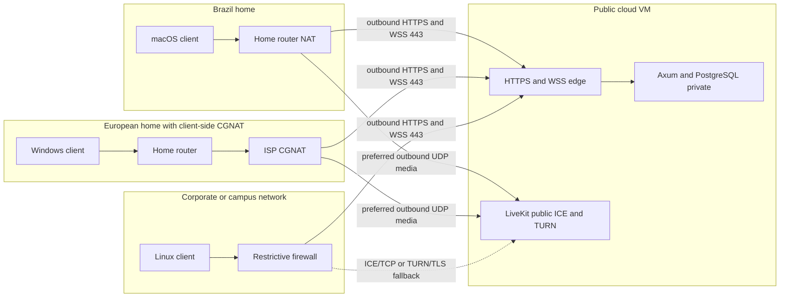
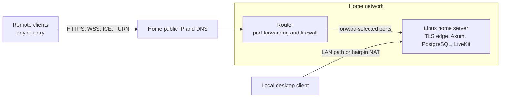
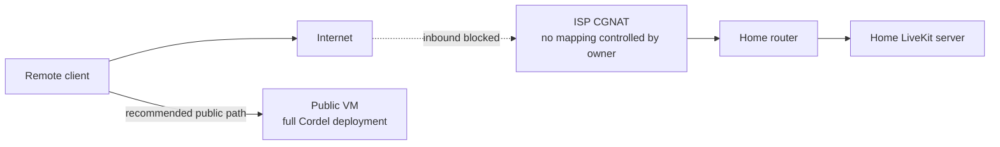
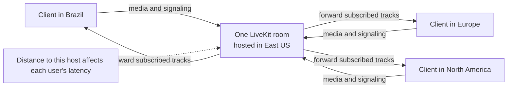

# Connectivity and distance

Detailed network design for the [Cordel deployment architecture](../../architecture.md). This is a proposed baseline; the [ADR status ledger](../adr/STATUS.md) records tested paths.

## 3. Client connectivity: NAT, CGNAT, and distance

### 3.1 Public cloud VM, clients on different networks

Client-side NAT, including CGNAT, usually permits outbound connections. It does not require inbound router forwarding at the client's home. Axum signaling uses outbound HTTPS/WSS. WebRTC ICE tests available paths to the public LiveKit host. A restrictive client network may need TCP or TURN. The server therefore needs reachable media endpoints even though most clients do not.



The dotted fallback is a possibility, not a guarantee. Firewall policies vary. A client behind CGNAT can still reach a public LiveKit server through outbound traffic; TURN is used only when ICE cannot select a better path. TURN on the **same** server does not eliminate its bandwidth cost. It adds an extra relay leg and can increase latency. Verify UDP, TCP, and TURN behavior from real residential and corporate networks before calling connectivity complete. See [WebRTC's ICE and TURN explanation](https://webrtc.org/getting-started/peer-connections) and [TURN guidance](https://webrtc.org/getting-started/turn-server).

### 3.2 Home server with a public address on its router

A home server commonly has a private LAN address. The router must forward the public TCP and UDP ports used by the selected LiveKit configuration to that server. A public IPv4 address may be dynamic; dynamic DNS can update the names, but address changes can interrupt active rooms. Use a DHCP reservation or static LAN address for the server. Keep DNS TTLs reasonably short if the public address changes. Certificate issuance requires public DNS and a reachable ACME challenge route, unless using a supported DNS challenge. The home's **upload** bandwidth is the effective outbound capacity to participants.



Local clients should be tested separately: some routers do not support hairpin NAT for the public DNS name. Split-horizon DNS can resolve the same hostname to the server's LAN address internally while preserving valid TLS names. Local network success does not prove remote Internet reachability.

### 3.3 Home server behind server-side CGNAT

This is materially different from a **client** behind CGNAT. If the ISP does not provide an inbound-reachable public IPv4 address, ordinary port forwarding on the home router cannot expose LiveKit to the Internet. A generic HTTPS tunnel may expose Axum signaling but does not automatically carry LiveKit's UDP media. IPv6 can help only if the server has globally reachable IPv6 and every intended client has a working compatible path; dual-stack access still needs a plan.



**Decision:** obtain a public address from the ISP or place the complete public deployment on a VM. A public VM carrying only TURN while the SFU stays behind CGNAT is possible in specialized designs, but it adds relaying, reachability, and operations complexity without reducing the public bandwidth bill. Do not choose it for the first deployment.

### 3.4 People in different countries

One LiveKit room is hosted on one LiveKit node, even in a distributed LiveKit cluster. In the first test deployment every participant's media goes through East US. Axum and PostgreSQL live on the same host so chat and authorization do not add a second cross-region hop. A participant far from the host can have a higher round-trip time; adding regional application replicas alone does not shorten the media path for that room. Measure end-to-end latency and packet loss from the intended countries before considering a different region or multi-region deployment. [LiveKit's distributed deployment guide](https://docs.livekit.io/transport/self-hosting/distributed/) describes the one-node-per-room constraint.



Two European participants in the same room still exchange media through East US. This is an architectural path statement, not a fixed latency estimate. Measure RTT and jitter from the intended countries. If international use later dominates, evaluate region selection per room and a distributed deployment; that is a separate scaling decision and requires Redis and more than one node.

### 3.5 Session establishment and media path

```mermaid
sequenceDiagram
  participant C as Desktop client
  participant A as Axum
  participant D as PostgreSQL
  participant L as LiveKit
  C->>A: HTTPS login or token refresh
  A->>D: Validate account and session
  A-->>C: Short-lived app access token
  C->>A: WSS chat connect with app token
  A-->>C: Authorized channel events
  C->>A: POST voice token for channel
  A->>D: Check current membership and CONNECT_VOICE
  A-->>C: Room-scoped LiveKit token and media URL
  C->>L: WSS LiveKit signaling
  C->>L: ICE candidate checks; UDP preferred
  Note over C,L: ICE/TCP or TURN may be selected instead
  C->>L: Encrypted WebRTC microphone and screen tracks
  L-->>C: Subscribed tracks from other participants
  L->>A: Signed participant webhook
  A->>L: Participant reconciliation or removal if needed
```

Webhooks update the UI's view of voice presence but are not an authorization source. Axum checks the database before issuing each new room token. The client obtains any replacement app token through the app's session flow, not from LiveKit.

### 3.6 Invitation, reconnection, and moderation

```mermaid
sequenceDiagram
  participant Admin
  participant Invitee
  participant Client
  participant Axum
  participant DB as PostgreSQL
  participant LK as LiveKit
  Admin->>Axum: Create invitation (authenticated admin)
  Axum->>DB: Store expiring, limited-use invite
  Axum-->>Admin: Shareable invite code
  Admin-->>Invitee: Give invite code
  Invitee->>Axum: Redeem invite and choose login/password
  Axum->>DB: Atomically consume invite, create account and membership
  Axum-->>Invitee: Authenticated session
  Client->>Axum: Reconnect after network drop
  Axum->>DB: Recheck session, membership, kick/ban state
  Axum-->>Client: Resume if still authorized; recover missed messages
  Admin->>Axum: Kick a user for 30+ minutes or ban a user
  Axum->>DB: Persist restriction
  Axum-->>Client: Close affected app and chat access
  Axum->>LK: Remove active participant
  Client->>Axum: Attempt new app/media admission
  Axum-->>Client: Deny while restriction remains
```

The last denial represents Axum's own endpoints. A previously issued self-hosted LiveKit token may still reach LiveKit directly; section 7 and the parking lot track the additional enforcement needed. Invite redemption must be atomic so a single-use code cannot create two accounts under concurrent requests.

### 3.7 Browser test path

The browser test client calls the same HTTPS API and uses LiveKit's browser SDK for microphone and screen sharing. It does not reuse the native Rust media or Slint UI code. Browser WebSocket APIs cannot set a custom `Authorization` request header, so the browser needs a deliberately designed authentication method, such as a short-lived, single-use WebSocket ticket obtained over authenticated HTTPS or a secure same-site cookie. Do not place a long-lived bearer token in a WebSocket URL. Scope browser credentials and CORS/origin rules to the deployment's actual domain. The browser is a test surface; parity with all native features is not an initial gate.
